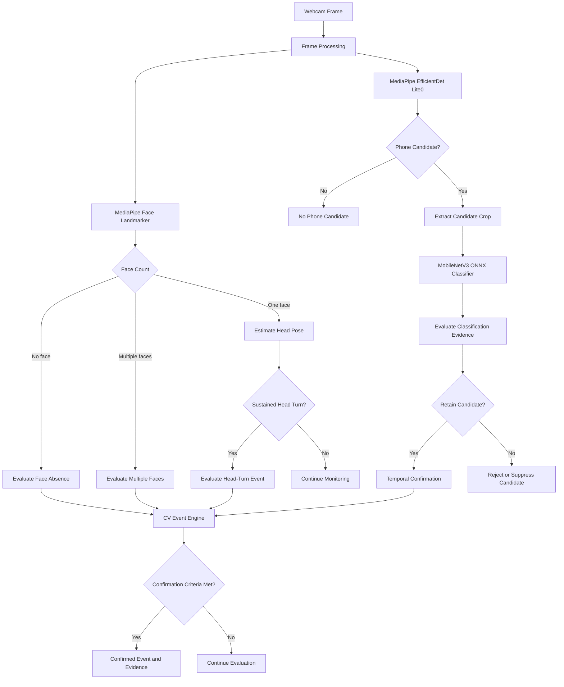
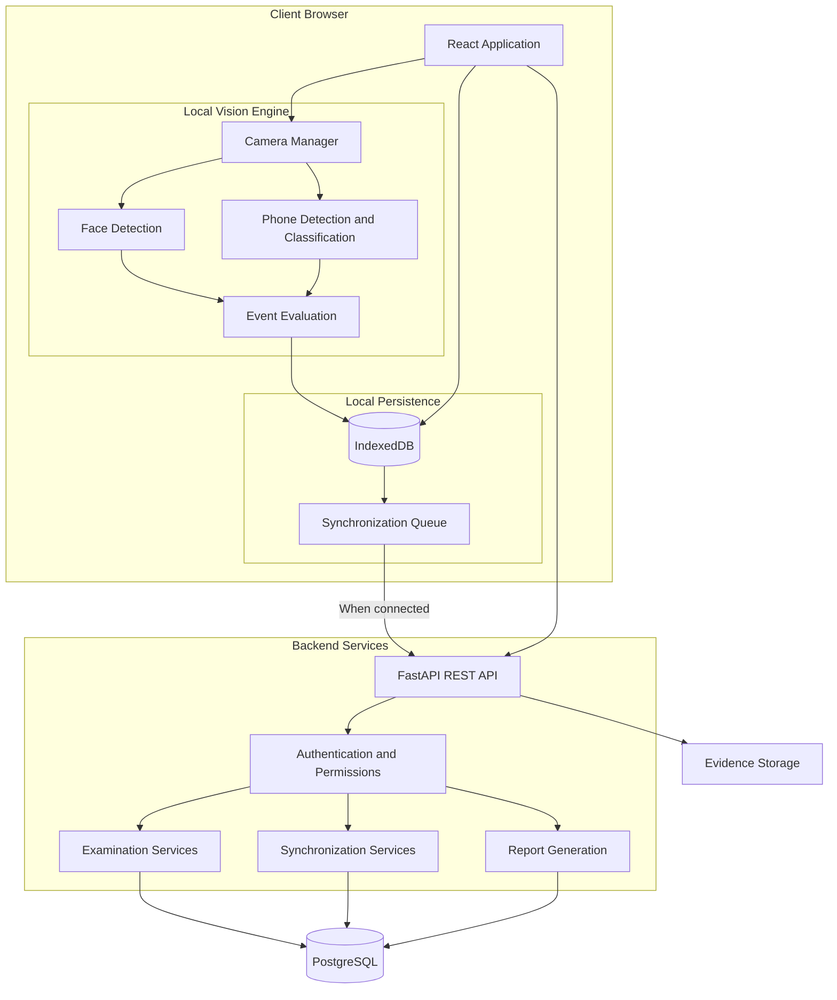
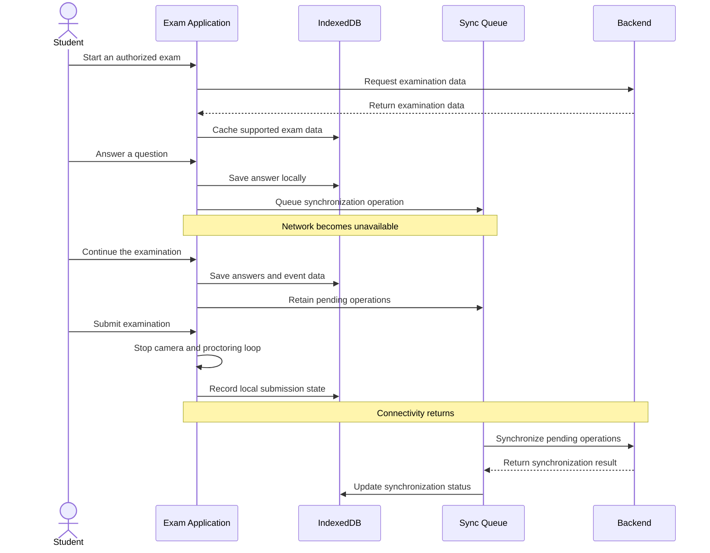
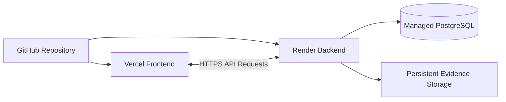

# ExamProctor.ai

### Local-First Examination Management & AI-Powered Proctoring

ExamProctor.ai is an examination management platform designed to support secure, resilient online assessments. It combines browser-based computer vision, local answer persistence, offline synchronization, and evidence-based examination review.

The goal is simple: **help students continue their exams during network interruptions while giving educators useful tools to review examination activity.**

> **Academic integrity notice:** Computer-vision detections are indicators for human review, not proof of misconduct. Authorized educators must evaluate the context before making academic decisions.

---

## ✨ Key Features

| Feature | Description |
|---|---|
| 📝 Exam Management | Create, configure, publish, and manage examinations. |
| 👥 Role-Based Access | Separate interfaces and permissions for students, professors, and administrators. |
| ⏱️ Timed Assessments | Exam timers, question navigation, answer saving, and submission workflows. |
| 📡 Offline Continuity | Store exam data locally and queue changes when the network is unavailable. |
| 👁️ Face Monitoring | Detect face absence, multiple faces, and sustained head movements. |
| 📱 Phone Detection | Use a multi-stage vision pipeline to distinguish likely phones from common lookalikes. |
| 📸 Evidence Capture | Associate relevant snapshots with detected events for later review. |
| 🔄 Automatic Synchronization | Synchronize queued examination data when connectivity returns. |
| 📊 Examination Review | Review attempts, event timelines, snapshots, and assessment results. |
| 📄 PDF Reports | Generate examination reports for authorized review. |
| 🎥 Recorded Video Analysis | Analyze supported video uploads using the proctoring pipeline. |
| 🔐 Access Control | Apply authentication and role-based permissions to protected features. |
| 📷 Camera Lifecycle | Release webcam tracks when proctoring stops or an exam is submitted. |

---

## 🧠 Computer-Vision Pipeline

ExamProctor.ai performs its primary webcam inference directly in the student's browser using local machine-learning models and WebAssembly.

**Webcam frames are processed locally; the application is designed to upload relevant evidence and event data rather than continuously stream webcam video to the backend.**

### Detection workflow



### Detection capabilities

- **Face absence:** Evaluate periods when no face is detected.
- **Multiple faces:** Identify frames containing more than one face.
- **Head movement:** Estimate facial orientation and evaluate sustained head turns.
- **Phone candidates:** Detect likely phones and classify candidate crops.
- **Temporal verification:** Evaluate whether a condition persists before confirming an event.
- **Evidence review:** Preserve relevant event information for authorized examination review.

### Multi-stage phone detection

The phone pipeline combines two models:

1. **MediaPipe EfficientDet Lite0** identifies candidate objects.
2. **MobileNetV3-Large**, executed through ONNX Runtime Web, classifies candidate crops.

The classifier distinguishes four categories:

- Calculator
- Cardboard cutout
- Empty phone case
- Real phone

A decision policy evaluates detector confidence and classifier output to reduce false positives from common lookalike objects.

**Important:** Model predictions are not guaranteed to be correct. Detection quality can vary with lighting, camera quality, object visibility, and viewing angle. The pipeline should be evaluated using representative test cases before operational use.

---

## 🏗️ System Architecture

The platform separates the browser-based examination experience from backend services.



### Architecture principles

- **Local-first:** Keep supported examination data available in browser storage.
- **Privacy-conscious:** Process webcam frames locally rather than continuously transmitting video.
- **Resilient synchronization:** Queue changes during network interruptions and retry when connectivity returns.
- **Separation of responsibilities:** Keep examination interfaces, vision processing, local storage, and backend services distinct.
- **Human oversight:** Provide event information for review rather than automatically deciding academic misconduct.

---

## 📡 Offline Examinations & Synchronization

Network interruptions should not immediately terminate an active examination.

ExamProctor.ai uses browser-based persistence and a synchronization queue to support continuity.



### Synchronization goals

- Save supported changes locally.
- Preserve queued operations during temporary network failures.
- Use operation identifiers and sequencing to support reliable synchronization.
- Retry eligible operations when connectivity returns.
- Distinguish local submission from server-confirmed submission.

**Offline limitations:** Initial access, authentication, and downloading an examination may still require connectivity. Actual offline behavior depends on previously cached data, browser storage availability, and the application's current state.

---

## 👥 User Roles

### Student
- Access authorized examinations.
- Complete the system readiness check.
- Answer questions and track examination progress.
- Continue supported exam activities during connectivity interruptions.
- Submit answers and check synchronization status.

### Professor
- Create and manage examinations.
- Prepare questions and configure assessment settings.
- Monitor examination activity.
- Review submitted attempts, event timelines, and evidence.
- Review responses and generate reports.
- Manage authorized retakes where supported.

### Administrator
- Manage user accounts and access permissions.
- Review administrative activity.
- Configure supported system settings.
- Oversee platform administration.

---

## 🛠️ Technology Stack

| Layer | Technologies |
|---|---|
| Frontend | React, Vite, JavaScript, CSS |
| Routing | React Router |
| Local Storage | IndexedDB, Dexie.js |
| Face Detection | MediaPipe Tasks Vision |
| Object Detection | MediaPipe EfficientDet Lite0 |
| Image Classification | MobileNetV3, ONNX Runtime Web |
| Browser Inference | WebAssembly (WASM) |
| Backend | Python, FastAPI, Uvicorn |
| Data Validation | Pydantic |
| ORM and Migrations | SQLAlchemy, Alembic |
| Database | PostgreSQL |
| Authentication | JWT-based authentication and password hashing |
| PDF Reports | ReportLab |
| Spreadsheet Processing | OpenPyXL |
| Frontend Testing | Node.js test runner |
| Backend Testing | Pytest |

---

## 📂 Project Structure

```text
ExamProctor.ai/
├── README.md
├── docker-compose.yml
├── docs/
│   ├── architecture.md
│   ├── api-contracts.md
│   ├── data-model.md
│   ├── sync-protocol.md
│   └── testing-plan.md
├── backend/
│   ├── app/
│   │   ├── api/v1/
│   │   ├── core/
│   │   ├── db/
│   │   └── schemas/
│   ├── alembic/
│   ├── tests/
│   ├── requirements.txt
│   └── .env.example
├── frontend/
│   ├── public/
│   │   ├── models/
│   │   ├── mediapipe/
│   │   └── onnx/
│   ├── src/
│   │   ├── components/
│   │   ├── contexts/
│   │   ├── pages/
│   │   ├── proctoring/
│   │   ├── services/
│   │   ├── storage/
│   │   └── workers/
│   ├── tests/
│   └── package.json
└── tools/
```

The repository includes the frontend, backend, local machine-learning assets, automated tests, and supporting technical documentation.

---

## 🚀 Getting Started

### Prerequisites

Install the following software:

- Git
- Node.js and npm
- Python
- PostgreSQL or another supported PostgreSQL hosting option

Use compatible versions for the dependencies specified by the project.

### 1. Clone the repository

```bash
git clone https://github.com/Tejasdev-97/ExamProctoring.git
cd ExamProctoring
```

### 2. Configure the backend

Open a terminal in the repository directory.

**Windows PowerShell:**

```powershell
cd backend

python -m venv .venv
.\.venv\Scripts\Activate.ps1

python -m pip install --upgrade pip
pip install -r requirements.txt

Copy-Item .env.example .env
```

Open `backend/.env` and configure the required settings using your own local development values.

Do not commit this file.

After configuring the database connection and required application settings, run:

```powershell
alembic upgrade head
python bootstrap.py
uvicorn app.main:app --reload --port 8000
```

Backend address: `http://localhost:8000`

### 3. Configure the frontend

Open a second terminal:

```powershell
cd frontend

npm install
npm run dev
```

The Vite development server normally runs at:

`http://localhost:5173`

If the backend uses a different address, configure the frontend API base URL using the appropriate local environment variable.

### 4. Open the application

Visit the frontend address printed by Vite.

Ensure the backend and database are running, and that the required environment variables are configured.

> **First-time setup:** Account creation and initial administrator provisioning depend on the application's bootstrap configuration. Set your own credentials; do not rely on example passwords in a production environment.

---

## ⚙️ Configuration

The application uses environment variables to separate local development settings from deployment settings.

### Backend

Create `backend/.env` from the provided example file and configure the settings required by the backend.

Depending on the environment, these may include:

- Application environment
- Authentication signing key
- Database connection settings
- Allowed frontend origins
- Initial administrator provisioning
- Evidence storage configuration
- Upload limits

Use strong, unique secrets and valid connection details for your own environment.

### Frontend

The frontend can use a Vite environment variable to identify the backend API base URL.

For example, in a local development environment:

```dotenv
VITE_API_BASE_URL=http://localhost:8000/api/v1
```

Use the actual API URL for your deployment.

**Security rule:** Never place database credentials, authentication secrets, private keys, or other confidential values in frontend variables. Values prefixed with `VITE_` may become visible in the browser.

---

## 🧪 Testing

The project includes frontend and backend test suites.

### Frontend tests

```powershell
cd frontend
npm test
```

### Production frontend build

```powershell
cd frontend
npm run build
```

### Backend tests

```powershell
cd backend
python -m pytest -v
```

Run the relevant tests after making changes, and verify the application manually before using it for an actual examination.

---

## ☁️ Deployment

ExamProctor.ai can be deployed using separate frontend and backend hosting services.



### Frontend deployment

The frontend can be deployed to a static hosting platform such as Vercel.

Typical configuration:

| Setting | Value |
|---|---|
| Repository | `Tejasdev-97/ExamProctoring` |
| Root directory | `frontend` |
| Build command | `npm run build` |
| Output directory | `dist` |

Configure the frontend's API base URL to point to the deployed backend.

### Backend deployment

The FastAPI backend can be deployed as a web service on a compatible Python hosting platform, such as Render.

Typical start command:

```bash
uvicorn app.main:app --host 0.0.0.0 --port $PORT
```

Configure the required environment variables in the hosting provider's private settings.

The backend also needs a reachable PostgreSQL database and an appropriate evidence-storage strategy.

### Deployment considerations

- Configure CORS to permit the deployed frontend origin.
- Use HTTPS in production.
- Keep credentials and signing keys out of Git.
- Use persistent or object storage for evidence that must survive service restarts.
- Configure database migrations and verify application health after deployment.
- Check hosting limits before relying on the service for scheduled examinations.

### Automatic deployments

Connect the GitHub repository to the selected hosting providers and enable deployments from the `main` branch.

After the initial setup, changes pushed to GitHub can trigger new deployments automatically.

---

## 🔒 Security, Privacy & Responsible Use

ExamProctor.ai is designed with the following principles:

- **Local computer vision:** Webcam frames are processed in the browser by the local vision pipeline.
- **Limited evidence collection:** Relevant event data and snapshots may be saved for examination review.
- **Protected access:** Authentication and role-based permissions help restrict access to application features.
- **Camera cleanup:** The application attempts to release camera tracks when proctoring ends.
- **Human review:** Visual detections should be reviewed in context by authorized educators.
- **Responsible retention:** Institutions should establish appropriate evidence-retention and access policies.

### Important limitations

No computer-vision system can guarantee perfect detection or eliminate false positives.

Lighting, camera position, occlusion, browser behavior, and device performance can affect results. A detected object or movement should not independently determine whether a student has violated examination rules.

Institutions should communicate monitoring practices to students and comply with applicable privacy and educational requirements.

---

## 🛣️ Roadmap

Potential future improvements include:

- [ ] Improved detection evaluation using diverse real-world test data.
- [ ] More robust offline application startup and model caching.
- [ ] Additional evidence-storage integrations.
- [ ] Improved synchronization recovery and diagnostics.
- [ ] Expanded accessibility and mobile-browser testing.
- [ ] Learning-management-system integrations.
- [ ] More comprehensive performance and security testing.

---

## 🤝 Contributing

Contributions, bug reports, and suggestions are welcome.

1. Fork the repository.
2. Create a feature branch.
3. Make a focused change.
4. Run the relevant tests.
5. Submit a pull request with a clear explanation of the change.

Example:

```bash
git checkout -b feature/my-improvement
```

Please avoid including credentials, personal examination data, or confidential evidence in commits and issue reports.

---

## 📄 License

The project's license has not yet been finalized.

Until a license is added to the repository, do not assume that the source code is available for unrestricted redistribution or commercial use.

---

## 🙏 Acknowledgements

ExamProctor.ai builds on open-source technologies, including:

- [React](https://react.dev/)
- [Vite](https://vite.dev/)
- [MediaPipe](https://developers.google.com/mediapipe)
- [ONNX Runtime Web](https://onnxruntime.ai/docs/get-started/with-javascript/web.html)
- [FastAPI](https://fastapi.tiangolo.com/)
- [SQLAlchemy](https://www.sqlalchemy.org/)
- [Dexie.js](https://dexie.org/)
- [ReportLab](https://www.reportlab.com/)

---

<p align="center">
  <strong>ExamProctor.ai</strong><br>
  Reliable examinations. Local-first processing. Human-centered review.
</p>