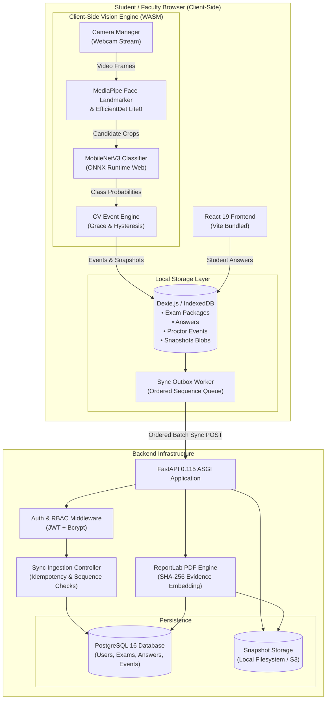
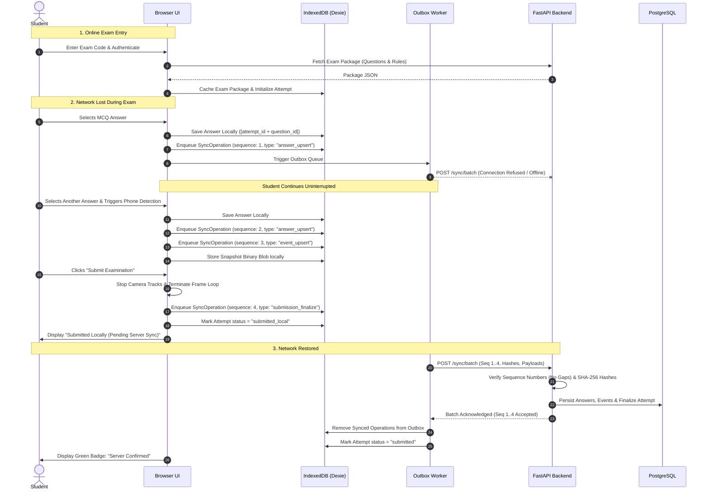
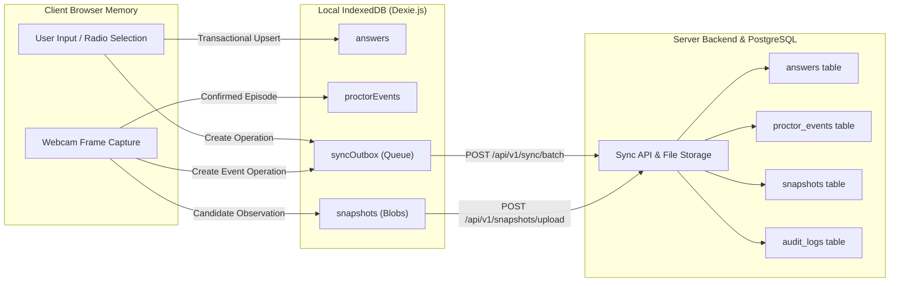
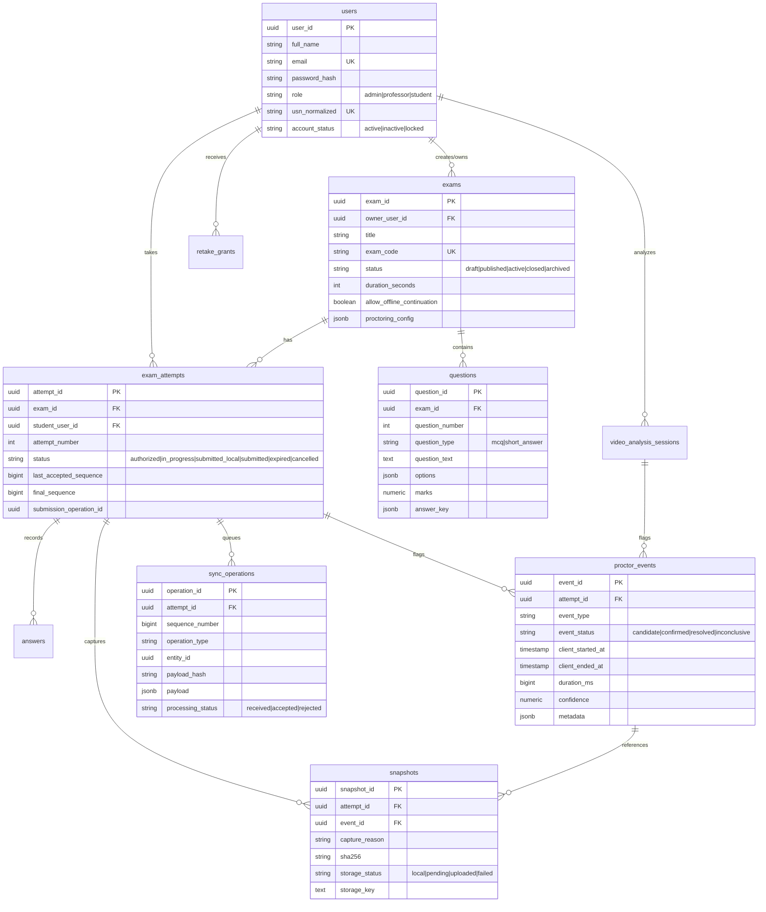
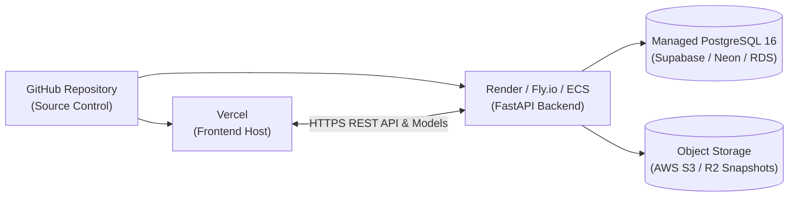

# ExamProctor.ai

**A resilient, local-first examination management and computer-vision proctoring platform designed for modern academic institutions.**

ExamProctor.ai integrates end-to-end examination administration, multi-stage in-browser computer-vision monitoring, automated evidence logging, and robust offline continuity. Engineered to address network instability during remote or in-lab examinations, the platform ensures that students can complete assessments without losing work or proctoring coverage, even during complete connectivity loss.

> ⚠️ **Important Academic Notice & Human-Review Disclaimer**  
> Computer-vision detections generated by ExamProctor.ai describe observable visual conditions and serve strictly as **technical indicators for human review**, not as conclusive proof of misconduct or academic dishonesty. All flagged events, snapshots, and metrics require contextual evaluation by authorized professors or examination boards. ExamProctor.ai does not automatically determine academic penalties.

---

## Table of Contents

- [Problem Statement](#problem-statement)
- [Project Objectives](#project-objectives)
- [Key Features](#key-features)
- [User Roles & Permissions](#user-roles--permissions)
- [Technology Stack](#technology-stack)
- [System Architecture](#system-architecture)
- [Computer-Vision Pipeline](#computer-vision-pipeline)
- [Offline Architecture & Synchronization](#offline-architecture--synchronization)
- [Examination Lifecycle Workflows](#examination-lifecycle-workflows)
- [Data Flow & Storage Models](#data-flow--storage-models)
- [Database Schema & Entities](#database-schema--entities)
- [Project Directory Structure](#project-directory-structure)
- [Installation & Local Setup](#installation--local-setup)
- [Environment Variables](#environment-variables)
- [Testing & Quality Assurance](#testing--quality-assurance)
- [Production Build & Deployment Guide](#production-build--deployment-guide)
- [Security, Privacy & Ethics](#security-privacy--ethics)
- [Troubleshooting & FAQ](#troubleshooting--faq)
- [Current Limitations & Roadmap](#current-limitations--roadmap)
- [Contributing](#contributing)
- [License](#license)
- [Acknowledgements & References](#acknowledgements--references)

---

## Problem Statement

Digital examinations face critical operational vulnerabilities:

1. **Network Fragility**: Unreliable Wi-Fi or transient outages can wipe out unsaved responses, abort ongoing sessions, or prevent timely submission.
2. **Supervision Gaps**: Remote and computer-lab examinations lack continuous, uniform invigilation to detect suspicious physical objects or unauthorized room occupants.
3. **Flawed Cloud Inference**: Streaming continuous webcam video to cloud servers consumes unfeasible bandwidth, incurs heavy server expenses, and introduces severe privacy risks.
4. **False Accusations from Naive AI**: Monolithic detection models routinely confuse innocuous objects (such as calculators or phone cases) with active cheating devices, generating false alarms and eroding academic trust.
5. **Disconnected Evidence**: When incidents occur, faculty often lack tamper-evident, timestamped visual snapshots tied directly to the exact millisecond of the reported event.

ExamProctor.ai addresses these challenges through a client-side vision pipeline, local IndexedDB transactional persistence, an ordered outbox synchronization protocol, and dual-stage AI verification.

---

## Project Objectives

- **Local-First Execution**: Enable seamless exam continuation and answer autosaving in IndexedDB during internet disruptions.
- **Ordered Data Synchronization**: Guarantee sequential, idempotent synchronization of answers, events, and evidence upon network restoration.
- **Edge AI Proctoring**: Execute all computer-vision inference 100% locally in the browser using WebAssembly (WASM), eliminating video streaming to remote servers.
- **Calibrated False-Positive Filtering**: Combine MediaPipe object candidate detection with a dedicated MobileNetV3 second-stage classifier to filter calculators, cardboard cutouts, and empty cases.
- **Clean Hardware Lifecycle**: Enforce strict camera shutdown on submission or unmount, preventing background camera leaks.
- **Tamper-Evident Reporting**: Generate standalone PDF reports embedding SHA-256 verified snapshot evidence and event timelines for faculty audit.

---

## Key Features

| Category | Feature | Description | Implementation Status |
| :--- | :--- | :--- | :--- |
| **Authentication & RBAC** | JWT Authentication | Bearer token & `httpOnly` cookie support with auto-refresh mechanism. | ✅ Implemented |
| **User Administration** | Student, Professor & Admin Management | Account creation, USN tracking, status toggling, password resets, and audit-safe anonymization. | ✅ Implemented |
| **Exam Builder** | Multi-Question Assessments | Author exams with configurable duration, navigation policies, proctoring parameters, and deadlines. | ✅ Implemented |
| **Question Ingestion** | Excel Import (`.xlsx`) | Batch question upload with row-by-row schema validation and interactive preview before commit. | ✅ Implemented |
| **Question Types** | MCQ & Short Answer | Multiple-choice questions with answer keys and open-ended text answers. | ✅ Implemented |
| **Student Delivery** | Timed Exam Interface | Question navigation, autosave indicators, local deadline enforcement, and submission confirmation. | ✅ Implemented |
| **Offline Engine** | IndexedDB Local Storage | Dexie.js transactional cache for exam packages, attempts, answers, events, and snapshot blobs. | ✅ Implemented |
| **Outbox Protocol** | Ordered Sync Outbox | Strictly sequenced outbox queue with SHA-256 payload canonical hashing and idempotency guards. | ✅ Implemented |
| **Vision: Face Absence** | Face Disappearance Monitoring | MediaPipe FaceLandmarker detection with configurable temporal grace period (default 5000ms). | ✅ Implemented |
| **Vision: Multiple Faces** | Unauthorized Occupant Detection | Multi-face mesh count with temporal verification grace period (default 2000ms). | ✅ Implemented |
| **Vision: Head Turn** | 3D Head Pose Tracking | Yaw and pitch rotation tracking computed from facial transformation matrices (default 30° thresholds). | ✅ Implemented |
| **Vision: Phone Detector** | MediaPipe EfficientDet Lite0 | Object detector running locally via WASM to extract candidate bounding boxes for cell phones. | ✅ Implemented |
| **Vision: Phone Classifier** | MobileNetV3 ONNX Runtime | Second-stage classifier discriminating real phones from calculators, cardboard cutouts, and cases. | ✅ Implemented |
| **Vision Policy** | Joint Decision Policy | Dual-model calibrated retention preventing false distractor alarms while preserving true phones. | ✅ Implemented |
| **Hardware Lifecycle** | Webcam Teardown | Idempotent track termination upon submission, unmount, or post-submission reload. | ✅ Implemented |
| **Evidence Logging** | Provisional & Confirmed Snapshots | Immediate local snapshot capture at candidate observation, promoted to evidence upon event confirmation. | ✅ Implemented |
| **Faculty Audit** | Attempt Review & Event Timeline | Chronological event logs, duration counters, visual bounding boxes, and snapshot inspection. | ✅ Implemented |
| **Report Generation** | Server-Side PDF Reports | ReportLab PDF compilation embedding verified JPEG evidence and human-review disclaimers. | ✅ Implemented |
| **Video Analysis** | Recorded Video Proctoring | Post-exam uploaded MP4/WebM video analysis using the exact same detector/classifier engine. | ✅ Implemented |
| **Retake Management** | Authorized Retakes | Professor-granted retakes with dedicated attempt tracking, audit logging, and attempt number increments. | ✅ Implemented |
| **System Settings** | Dynamic System Configuration | Global administration of proctoring thresholds, grace durations, and sampling intervals. | ✅ Implemented |

---

## User Roles & Permissions

ExamProctor.ai implements role-based access control (RBAC) enforced via FastAPI dependencies on the backend and React Context Route Guards on the frontend.

| Role | Permitted Capabilities & Scopes |
| :--- | :--- |
| **Student** (`student`) | - Log in and view assigned examination invitations.<br>- Complete hardware system readiness check (webcam & permissions).<br>- Download local exam package and start authorized attempts.<br>- Autosave answers and proctoring evidence locally to IndexedDB.<br>- Synchronize outbox queue and finalize submission.<br>- Review own past exam attempt statuses and submission receipts. |
| **Professor** (`professor`) | - Create, edit, publish, close, and archive examinations.<br>- Import question banks via Excel spreadsheet or manual builder.<br>- Configure exam-specific proctoring parameters and thresholds.<br>- Live monitoring dashboard of in-progress student sessions.<br>- Review completed attempts, event timelines, and snapshot evidence.<br>- Grade short-answer responses and publish finalized scores.<br>- Issue authorized student retakes with recorded justification.<br>- Generate and download official examination PDF reports.<br>- Execute recorded-video proctoring analysis on uploaded files. |
| **Administrator** (`admin`) | - Full superuser access across all academic entities.<br>- Manage user accounts (students, professors, administrators).<br>- Reset user credentials and perform academic-safe account anonymization.<br>- Inspect immutable system audit logs.<br>- Configure global system settings and proctoring defaults.<br>- Oversee database integrity, storage limits, and server operations. |

---

## Technology Stack

### Frontend Architecture

| Component | Technology | Version | Purpose |
| :--- | :--- | :--- | :--- |
| **UI Framework** | React | `^19.2.8` | Declarative user interface and component architecture |
| **Build Tool** | Vite | `^8.3.0` | Ultra-fast development server, HMR, and production bundler |
| **Routing** | React Router DOM | `^7.18.4` | Client-side routing, protected layouts, and route guards |
| **Client Database** | Dexie.js (IndexedDB) | `^4.4.6` | Structured local-first transactional storage |
| **Face & Object Detection** | MediaPipe Tasks Vision | `^1.1.1` | In-browser FaceLandmarker & EfficientDet Lite0 inference via WASM |
| **Deep Learning Classifier** | ONNX Runtime Web | `^1.30.0` | In-browser execution of MobileNetV3-Large ONNX classifier |
| **HTTP Client** | Axios | `^1.20.0` | REST API requests, interceptors, and Bearer token management |
| **Icons & Design** | Lucide React | `^1.59.0` | Modern SVG iconography |
| **Styling** | Vanilla CSS Modules | Native | Modular scoped CSS styling with unified design tokens |
| **Testing** | Node.js Test Runner | Native | Unit and integration test suite (`node --test`) |

### Backend Architecture

| Component | Technology | Version | Purpose |
| :--- | :--- | :--- | :--- |
| **Web Framework** | FastAPI | `0.115.5` | Asynchronous high-performance REST API |
| **ASGI Server** | Uvicorn | `0.32.1` | Production ASGI web server |
| **Data Validation** | Pydantic / Pydantic Settings | `2.10.3` | Request/response schema validation and settings parsing |
| **ORM** | SQLAlchemy | `2.0.36` | Asynchronous Object Relational Mapping |
| **Database Drivers** | asyncpg / psycopg2-binary | `0.30.0` / `2.9.10` | High-throughput asynchronous and synchronous PostgreSQL drivers |
| **Database Migrations** | Alembic | `1.14.0` | Version-controlled schema migrations |
| **Authentication** | python-jose / bcrypt | `3.3.0` / `>=4.2` | JWT token signing, claims verification, and bcrypt hashing |
| **PDF Generation** | ReportLab | `4.2.5` | High-fidelity server-side PDF generation with embedded images |
| **Excel Ingestion** | OpenPyXL | `3.1.5` | Parsing and validating question spreadsheets |
| **File Handling** | aiofiles | `24.1.0` | Non-blocking snapshot image persistence on filesystem |
| **Testing** | Pytest / pytest-asyncio | `8.3.4` / `0.24.0` | Automated backend testing framework |

---

## System Architecture

The following diagram illustrates the component architecture, showing separation between client-side execution, local-first storage, the FastAPI backend, and PostgreSQL storage:



---

## Computer-Vision Pipeline

Proctoring runs **100% locally on the student's device**, preserving bandwidth and privacy. Video frames are never sent over the network.

### Multi-Stage Detection Flow

```mermaid
flowchart TD
    FRAME["Webcam Video Frame (640x480)"] --> SPLIT{"Frame Processing"}
    
    %% Face Branch
    SPLIT -->|Face Landmark Path| FACE_DET["MediaPipe Face Landmarker<br/>(face_landmarker.task)"]
    FACE_DET --> FACE_COUNT{"Face Count?"}
    FACE_COUNT -->|0 Faces| FA_GRACE["Evaluate Face Absent<br/>(Grace Period: 5000ms)"]
    FACE_COUNT -->|1 Face| POSE["Extract 4x4 Matrix<br/>Compute Yaw & Pitch"]
    FACE_COUNT -->|>1 Faces| MF_GRACE["Evaluate Multiple Faces<br/>(Grace Period: 2000ms)"]
    POSE --> HT_CHECK{"|Yaw| or |Pitch| > 30°?"}
    HT_CHECK -->|Yes| HT_GRACE["Evaluate Head Turn<br/>(Duration: 3000ms)"]
    HT_CHECK -->|No| CALM["Pose Within Thresholds"]

    %% Phone Detection Branch
    SPLIT -->|Object Detector Path| OBJ_DET["MediaPipe EfficientDet Lite0<br/>(scoreThreshold: 0.30)"]
    OBJ_DET --> CAND_CHECK{"Candidate Found?<br/>('cell phone')"}
    CAND_CHECK -->|No| STAGE_A["Stage A: No Candidate"]
    CAND_CHECK -->|Yes| STAGE_B["Stage B: Extract Bounding Box Crop"]
    
    STAGE_B --> CROP_NORM["Stage C: Resize to 224x224 RGB<br/>ImageNet Mean/Std Normalization"]
    CROP_NORM --> ONNX_CLS["Stage D/E: MobileNetV3 ONNX Classifier<br/>(phone_classifier.onnx)"]
    
    ONNX_CLS --> DECISION{"Stage F: Calibrated Decision Policy"}
    DECISION -->|p(calc) >= 0.70 or p(case/cutout) >= 0.68| SUPPRESS["Reject Candidate<br/>(Distractor Suppressed)"]
    DECISION -->|p(real_phone) >= 0.60 or det >= 0.75| RETAIN["Retain Candidate<br/>(Calibrated Conf >= 0.65)"]
    DECISION -->|Weak det (<0.65) & uncertain| REJECT_UNC["Reject Candidate<br/>(Low Confidence)"]
    
    RETAIN --> ENGINE["CV Event Engine<br/>(phone_confirm_ms: 1000ms)"]
    FA_GRACE --> ENGINE
    MF_GRACE --> ENGINE
    HT_GRACE --> ENGINE
    
    ENGINE --> STAGE_G{"Stage G: Temporal Grace Passed?"}
    STAGE_G -->|Yes| CONFIRMED["Emit CONFIRMED Event<br/>Promote Snapshot to Evidence"]
    STAGE_G -->|No (vanished)| REJECTED["Emit REJECTED Event<br/>Discard Provisional Snapshot"]
```

### Monitored Visual Conditions

1. **Face Absence (`face_absent`)**:
   - Detected using `FaceLandmarker`.
   - Condition triggers if 0 faces are detected continuously for the configured grace period (default `5000ms`).
   - Tolerate transient blinks or brief occlusions via release hysteresis (`1000ms`).
2. **Multiple Faces (`multiple_faces`)**:
   - Condition triggers if $\ge 2$ faces appear in frame continuously for the grace period (default `2000ms`).
   - Immediate provisional snapshot captured at candidate observation; promoted to deliverable evidence upon confirmation.
3. **Sustained Head Turn (`sustained_head_turn`)**:
   - Computes Euler angles (yaw and pitch) from facial landmark rotation matrices calibrated against a baseline established during the first 8 neutral frames.
   - Triggers if $|\text{yaw}| > 30^{\circ}$ or $|\text{pitch}| > 30^{\circ}$ continuously for `3000ms`.
4. **Phone Candidate Detection & Classification (`phone_detected`)**:
   - **First Stage**: MediaPipe EfficientDet Lite0 identifies candidate objects labeled `"cell phone"` ($\ge 0.30$ score).
   - **Crop Extraction**: Pixel coordinates are normalized and cropped from the raw video stream to 224x224 RGB.
   - **Second Stage**: MobileNetV3-Large ONNX classifier evaluates the crop across 4 trained classes:
     - `0: calculator` (common lookalike)
     - `1: cardboard_cutout` (spoofing artifact)
     - `2: empty_case` (accessory without device)
     - `3: real_phone` (active mobile device)
   - **Calibrated Decision Policy (`evaluatePhoneCandidate`)**:
     - *Distractor Suppression*: If the classifier confidently predicts `calculator` ($\ge 0.70$ probability, $p(\text{phone}) < 0.20$), `cardboard_cutout`, or `empty_case$, the candidate is suppressed.
     - *Real Phone Confirmation*: If the classifier confirms `real_phone` ($\ge 0.60$ probability) with detector score $\ge 0.35$, the candidate is retained with combined confidence.
     - *Strong Detector Protection*: If the detector score is exceptionally high ($\ge 0.75$), the candidate is not discarded merely because the classifier is noisy; it is retained with an `isUncertain: true` flag for temporal grace evaluation.
     - *Uncertain Weak Candidates*: Ambiguous candidates with weak detector confidence ($< 0.65$) are rejected.
     - *Explicit Fallback*: If the classifier is unavailable, the pipeline falls back to detector-only evaluation and explicitly logs the fallback.
   - **Temporal Confirmation**: Retained phone candidates must persist continuously for `phone_confirm_ms` (default `1000ms`) before becoming a confirmed event.

### Hardware Camera Lifecycle Guarantee

To prevent webcam privacy violations:
- `CameraManager.stop()` explicitly stops every `MediaStreamTrack` using `track.stop()`, releases internal references, and detaches `videoElement.srcObject = null`.
- Cleanups are completely **idempotent**: duplicate calls to cleanup do not throw errors.
- Late asynchronous `getUserMedia()` requests resolving after submission or page unmount are intercepted and aborted immediately.
- In-flight detection frames checking `isStoppedRef` immediately abort and cannot emit post-exam proctoring events.

---

## Offline Examination and Synchronization

ExamProctor.ai is designed with an offline-first architecture to ensure exams proceed smoothly even when network connectivity is lost.



### Outbox Guarantees

1. **Strict Monotonic Sequencing**: Every operation within an attempt is assigned an incrementing sequence number ($1, 2, 3 \dots$). The server rejects batches with gaps, ensuring changes apply in exact chronological order.
2. **Canonical SHA-256 Hashes**: Payloads are sorted and formatted consistently to generate cryptographic SHA-256 hashes, preventing transmission corruption.
3. **Idempotent Retries**: Re-sending an already-acknowledged operation ID returns `accepted` without creating duplicate database rows.
4. **Permanent vs. Retryable Rejections**: Malformed requests advance the sequence past the error to avoid blocking the entire sync queue, whereas transient network drops retain operations for subsequent retry.
5. **Durable Snapshot Delivery**: Image binaries are queued in a separate upload tracker and sent independently, preventing heavy image payloads from delaying critical answer syncs.

---

## Examination Lifecycle Workflows

```mermaid
flowchart TD
    subgraph StudentFlow ["Student Examination Lifecycle"]
        S_LOGIN["Student Login<br/>(/login)"] --> S_DASH["Student Dashboard<br/>(/student)"]
        S_DASH --> S_ENTER["Enter 6-Digit Exam Code<br/>(/student/enter)"]
        S_ENTER --> S_READY["System Readiness Check<br/>(/student/readiness)"]
        S_READY --> S_SESSION["Active Exam Session<br/>(/student/exam/:attemptId)"]
        S_SESSION --> S_SUBMIT["Submit Exam & Stop Camera"]
        S_SUBMIT --> S_SYNC["Outbox Sync & Server Confirmation"]
    end

    subgraph ProfessorFlow ["Professor Audit & Management"]
        P_LOGIN["Professor Login"] --> P_DASH["Professor Dashboard<br/>(/professor)"]
        P_DASH --> P_CREATE["Exam Builder & Excel Upload<br/>(/professor/exams/new)"]
        P_DASH --> P_MONITOR["Live Session Monitoring<br/>(/professor/exams/:id/monitor)"]
        P_DASH --> P_REVIEW["Attempt Review & Grading<br/>(/professor/attempts/:id/review)"]
        P_REVIEW --> P_PDF["Export Official PDF Report"]
        P_DASH --> P_VIDEO["Recorded Video Analysis<br/>(/professor/video-analysis)"]
    end

    subgraph AdminFlow ["Administrator Governance"]
        A_LOGIN["Admin Login"] --> A_DASH["Admin Dashboard<br/>(/admin)"]
        A_DASH --> A_USERS["User Management & USN Admin<br/>(/admin/users)"]
        A_DASH --> A_AUDIT["Immutable Audit Logs<br/>(/admin/audit)"]
        A_DASH --> A_CONFIG["System Settings & Thresholds<br/>(/admin/settings)"]
    end
```



---

## Data Flow & Storage Models

Data moves between three primary storage layers:



---

## Database Schema & Entities

The PostgreSQL schema is managed via SQLAlchemy and versioned using Alembic. Primary entities include:



---

## Project Directory Structure

```
D:\ExamProctor.ai\
├── README.md                           # Main technical documentation
├── docker-compose.yml                  # Docker orchestration for PostgreSQL & Backend
├── docs/                               # Architectural specs & API contracts
│   ├── ExamProctor.ai-PRD.md          # Product Requirements Document
│   ├── api-contracts.md               # OpenAPI specification details
│   ├── architecture.md                # System architectural deep dive
│   ├── data-model.md                  # Entity relationship & constraint documentation
│   └── sync-protocol.md               # Outbox sequencing & reconciliation protocol
├── tools/                              # Offline ML export and utility scripts
│   └── export_classifier_onnx.py       # MobileNetV3 PyTorch checkpoint to ONNX converter
├── backend/                            # Python FastAPI Backend
│   ├── Dockerfile                     # Container definition (Python 3.13-slim)
│   ├── alembic.ini                    # Database migration configuration
│   ├── bootstrap.py                   # Initial admin account & default settings seeder
│   ├── requirements.txt               # Pinned Python package dependencies
│   ├── .env.example                   # Backend environment template
│   ├── alembic/                       # Migration scripts
│   │   └── versions/                  # Database migration versions
│   ├── app/                           # Application package
│   │   ├── main.py                    # FastAPI entrypoint, middleware, routers
│   │   ├── api/v1/                    # REST API route handlers
│   │   │   ├── auth.py                # Login, refresh tokens, user context
│   │   │   ├── users.py               # User CRUD, passwords, anonymization
│   │   │   ├── exams.py               # Exam creation, publishing, scoring
│   │   │   ├── questions.py           # Question authoring, Excel import
│   │   │   ├── attempts.py            # Student session initialization
│   │   │   ├── sync.py                # Outbox batch synchronization handler
│   │   │   ├── snapshots.py           # Evidence snapshot binary upload
│   │   │   ├── monitoring.py          # Real-time exam monitoring
│   │   │   ├── reports.py             # ReportLab PDF report generation
│   │   │   ├── retakes.py             # Retake authorization management
│   │   │   ├── settings.py            # System settings management
│   │   │   └── video_analysis.py      # Recorded-video analysis sessions
│   │   ├── core/                      # Application core utilities
│   │   │   ├── config.py              # Pydantic Settings loaded from .env
│   │   │   ├── security.py            # JWT and bcrypt operations
│   │   │   ├── permissions.py         # Role dependencies (require_role)
│   │   │   └── errors.py              # Standardized application exception handlers
│   │   ├── db/                        # Database connectivity & ORM
│   │   │   ├── session.py             # Async & sync engine and session factories
│   │   │   └── models.py              # SQLAlchemy database models
│   │   └── schemas/                   # Pydantic schemas
│   │       └── schemas.py             # Request & response data transfer models
│   └── tests/                         # Pytest automated test suite
│       ├── test_auth.py               # Authentication & token verification tests
│       ├── test_exam_lifecycle_and_grading.py # Exam authoring & scoring tests
│       ├── test_reports.py            # PDF report formatting tests
│       ├── test_security.py           # Bcrypt & claim security tests
│       ├── test_settings.py           # Setting validation tests
│       ├── test_sync_protocol.py      # Sync ordering & hash tests
│       ├── test_user_management.py    # User provisioning & USN tests
│       └── test_video_analysis.py     # Video session tests
└── frontend/                           # React 19 + Vite Frontend
    ├── package.json                   # Pinned npm dependencies & scripts
    ├── vite.config.js                 # Vite bundler, proxy & optimization config
    ├── index.html                     # HTML root entrypoint
    ├── public/                        # Static assets & offline ML models
    │   ├── models/                    # Machine learning models (offline local cache)
    │   │   ├── face_landmarker.task   # MediaPipe FaceLandmarker model (~3.8 MB)
    │   │   ├── efficientdet_lite0.tflite # MediaPipe ObjectDetector model (~7.3 MB)
    │   │   └── phone_classifier.onnx  # MobileNetV3 ONNX 4-class model (~17.1 MB)
    │   ├── mediapipe/wasm/            # MediaPipe Vision WebAssembly runtime
    │   └── onnx/                      # ONNX Runtime Web WASM binaries
    ├── src/                           # Application source code
    │   ├── main.jsx                   # React root rendering
    │   ├── App.jsx                    # Routing table & route protection
    │   ├── components/                # Shared layout & UI components
    │   ├── contexts/                  # AuthContext and ToastContext
    │   ├── pages/                     # Application pages
    │   │   ├── public/LandingPage.jsx # Public home page
    │   │   ├── auth/LoginPage.jsx     # User authentication page
    │   │   ├── student/               # Student exam entry, readiness, session
    │   │   ├── professor/             # Exam builder, dashboard, review, video
    │   │   └── admin/                 # User management, audit logs, settings
    │   ├── proctoring/                # Computer-vision proctoring engine
    │   │   ├── cameraManager.js       # Webcam lifecycle & track teardown
    │   │   ├── phoneClassifier.js     # ONNX runtime & evaluatePhoneCandidate
    │   │   ├── frameDetectors.js      # MediaPipe detector & classification loop
    │   │   ├── cvEventEngine.js       # Hysteresis, grace periods, episode tracking
    │   │   └── useProctoring.js       # React proctoring hook & evidence logic
    │   ├── storage/                   # Local storage & outbox subsystem
    │   │   ├── db.js                  # Dexie.js database schema
    │   │   ├── canonicalJson.js       # Deterministic hashing utility
    │   │   ├── outbox.js              # Sequence counter & outbox queue manager
    │   │   └── repositories.js        # Dexie repository abstraction layer
    │   ├── services/                  # Axios HTTP client configuration
    │   │   └── api.js                 # Base URL & 401 response interceptor
    │   └── workers/                   # Sync coordination hooks
    │       └── useSyncWorker.js       # Background outbox synchronizer
    └── tests/                         # Node.js test suite
        ├── cameraLifecycle.test.js    # Camera stop & async cancellation tests
        ├── canonicalJson.test.js      # Canonical JSON hash tests
        ├── cvEventEngine.test.js      # Temporal grace & confirmation tests
        ├── passiveLiveness.test.js    # Landmark micro-movement tests
        ├── phoneClassifier.test.js    # Model loading & decision policy tests
        ├── syncPlan.test.js           # Sequence reconciliation tests
        └── videoAnalysis.test.js      # Video pipeline tests
```

---

## Installation & Local Setup

### System Prerequisites

- **Node.js**: `v20.x` or `v22.x` LTS
- **npm**: `v10.x` or higher
- **Python**: `3.11` to `3.13`
- **PostgreSQL**: `v16` (Running locally or via Docker)
- **Git**: Installed and configured

---

### Step-by-Step Installation (Windows PowerShell)

#### 1. Database Provisioning

If using a local PostgreSQL installation, open `psql` or pgAdmin:

```sql
CREATE USER examproctor WITH PASSWORD 'examproctor';
CREATE DATABASE examproctor OWNER examproctor;
GRANT ALL PRIVILEGES ON DATABASE examproctor TO examproctor;
```

*(Alternatively, run `docker-compose up -d db` from the project root to launch a containerized PostgreSQL instance).*

#### 2. Backend Setup

Open a PowerShell terminal in the project directory:

```powershell
# Navigate to backend
cd D:\ExamProctor.ai\backend

# Create Python virtual environment
python -m venv .venv

# Activate virtual environment
.\.venv\Scripts\Activate.ps1

# Upgrade pip and install dependencies
pip install --upgrade pip
pip install -r requirements.txt

# Configure environment file
Copy-Item .env.example .env

# Run database schema migrations
alembic upgrade head

# Bootstrap initial admin account and default system settings
python bootstrap.py

# Start the backend development server
uvicorn app.main:app --reload --port 8000
```

- **Backend API**: `http://localhost:8000`
- **Swagger Documentation**: `http://localhost:8000/api/docs`
- **Health Check**: `http://localhost:8000/api/v1/health`

#### 3. Frontend Setup

Open a second PowerShell terminal:

```powershell
# Navigate to frontend
cd D:\ExamProctor.ai\frontend

# Install dependencies
npm install

# Start development server
npm run dev
```

- **Frontend Application**: `http://localhost:5173`

---

### Linux / macOS Setup Commands

```bash
# Backend Setup
cd backend
python3 -m venv .venv
source .venv/bin/activate
pip install --upgrade pip
pip install -r requirements.txt
cp .env.example .env
alembic upgrade head
python bootstrap.py
uvicorn app.main:app --reload --port 8000

# Frontend Setup (in a separate terminal)
cd frontend
npm install
npm run dev
```

---

### Initial Default Credentials

Seeded automatically by `python bootstrap.py` from `.env`:

| Role | Username / Email | Default Password |
| :--- | :--- | :--- |
| **System Administrator** | `admin@examproctor.ai` | `CHANGE_BEFORE_PRODUCTION` *(or value configured in `.env`)* |

> 🔒 **Security Notice**: Immediately log in to the Admin Dashboard at `http://localhost:5173/login` and update the administrator password under **User Management**.

---

## Environment Variables

### Backend Configuration (`backend/.env`)

| Variable | Type | Default Value | Description |
| :--- | :--- | :--- | :--- |
| `APP_ENV` | String | `development` | Runtime environment (`development`, `production`, `test`). Controls Swagger exposure. |
| `SECRET_KEY` | String | *Placeholder* | Cryptographic secret for signing JWT access and refresh tokens. Must be changed in production. |
| `ACCESS_TOKEN_EXPIRE_MINUTES` | Integer | `60` | JWT access token lifetime in minutes. |
| `REFRESH_TOKEN_EXPIRE_DAYS` | Integer | `7` | JWT refresh token lifetime in days. |
| `DATABASE_URL` | String | `postgresql+asyncpg://...` | Asynchronous database connection string used by FastAPI during application requests. |
| `SYNC_DATABASE_URL` | String | `postgresql+psycopg2://...` | Synchronous database connection string used by Alembic migrations and tooling. |
| `ALLOWED_ORIGINS` | Comma-Separated | `http://localhost:5173` | Permitted CORS origins. Must match frontend deployment origin. |
| `SNAPSHOT_STORAGE_TYPE` | String | `local` | Snapshot storage driver (`local` for filesystem, `s3` for cloud). |
| `SNAPSHOT_LOCAL_DIR` | String | `./storage/snapshots` | Destination folder on filesystem for JPEG snapshot evidence files. |
| `MAX_SNAPSHOT_SIZE_BYTES` | Integer | `5242880` (5 MB) | Maximum accepted file upload size for individual snapshot images. |
| `MAX_EXCEL_SIZE_BYTES` | Integer | `10485760` (10 MB) | Maximum permitted size for Excel question imports. |
| `MAX_EXCEL_ROWS` | Integer | `500` | Maximum question rows parsed during spreadsheet upload. |
| `BOOTSTRAP_ADMIN_EMAIL` | String | `admin@examproctor.ai` | Seed email used by `bootstrap.py` during first initialization. |
| `BOOTSTRAP_ADMIN_PASSWORD` | String | `CHANGE_BEFORE_PRODUCTION` | Seed password used by `bootstrap.py`. |

### Frontend Configuration (`frontend/`)

| Variable | Component | Default Value | Description |
| :--- | :--- | :--- | :--- |
| `VITE_API_BASE_URL` | Client (Vite) | `http://localhost:8000/api/v1` | Base REST API URL used by Axios client. |

> ⚠️ **Frontend Variable Safety**: All `VITE_*` variables are bundled into client-side JavaScript. **Never place secrets, private keys, or credentials in frontend environment variables.**

---

## Testing & Quality Assurance

Both frontend and backend include automated test suites to ensure pipeline integrity and prevent regressions.

### Running Backend Tests

Executes all 60 Pytest tests covering auth, token claims, exam scoring, PDF reports, system settings, and sync protocols:

```powershell
cd D:\ExamProctor.ai\backend
.\.venv\Scripts\python -m pytest -v
```

### Running Frontend Tests

Executes all 58 unit and integration tests covering camera teardown, canonical JSON hashing, CV event grace periods, passive liveness micro-movement, MobileNetV3 decision policies, and outbox sync plans:

```powershell
cd D:\ExamProctor.ai\frontend
npm test
```

### Running Production Bundle Build

Validates that all Vite module transformations, ONNX wasm asset references, and React components compile cleanly without syntax or bundling errors:

```powershell
cd D:\ExamProctor.ai\frontend
npm run build
```

---

## Production Build & Deployment Guide

This project can be deployed using standard modern cloud hosting providers.



### 1. GitHub Setup

Ensure the repository ignores secrets and builds before pushing:
```bash
git init
git add .
git commit -m "feat: initial commit of ExamProctor.ai platform"
git branch -M main
git remote add origin https://github.com/<your-username>/ExamProctor.ai.git
git push -u origin main
```

### 2. Frontend Deployment (Vercel)

1. Connect your GitHub repository to **Vercel**.
2. Set the **Root Directory** to `frontend`.
3. Build Settings:
   - **Framework Preset**: Vite
   - **Build Command**: `npm run build`
   - **Output Directory**: `dist`
   - **Install Command**: `npm install`
4. Environment Variables:
   - `VITE_API_BASE_URL`: `https://your-backend-api.onrender.com/api/v1`
5. Large Asset Caching: Vercel serves the `public/models/` and `public/onnx/` directories automatically. Ensure `dist/` contains the `.wasm` and `.onnx` files.

### 3. Backend Deployment (Render / Docker)

1. Create a **Web Service** on **Render** linked to the repository.
2. Set **Root Directory** to `backend`.
3. Set **Runtime** to `Python 3` or `Docker`.
4. Build & Start Commands:
   - **Build Command**: `pip install -r requirements.txt && alembic upgrade head`
   - **Start Command**: `uvicorn app.main:app --host 0.0.0.0 --port $PORT`
5. Environment Variables:
   - `APP_ENV`: `production`
   - `SECRET_KEY`: *(Generate a secure 64-character random string)*
   - `DATABASE_URL`: `postgresql+asyncpg://<user>:<pwd>@<host>:5432/<dbname>`
   - `SYNC_DATABASE_URL`: `postgresql+psycopg2://<user>:<pwd>@<host>:5432/<dbname>`
   - `ALLOWED_ORIGINS`: `https://your-examproctor.vercel.app`
   - `SNAPSHOT_STORAGE_TYPE`: `local` *(or configure S3 integration for stateless containers)*

---

## Security, Privacy & Ethics

ExamProctor.ai incorporates multiple layers of security and ethical safeguards:

1. **Client-Side Video Processing**: Webcam video is processed in volatile client memory and is **never** streamed or saved as full video files to server infrastructure.
2. **Deterministic Evidence Verification**: Every snapshot captured locally calculates a cryptographic SHA-256 hash. The server validates this hash before persisting evidence, preventing client-side image tampering.
3. **Hardware Privacy Protection**: Webcam hardware is strictly released as soon as an exam is submitted. The camera indicator LED turns off immediately, preventing background surveillance.
4. **Student Anonymization & Data Rights**: The Admin module includes an audit-safe user deletion feature. If a student account is removed, academic records are preserved while personally identifiable information (email, USN, full name) is scrubbed.
5. **No Automated Penalties**: Automated detection algorithms are strictly advisory. The system enforces human-in-the-loop governance: professors must review context before taking academic action.

---

## Troubleshooting & FAQ

### 1. Camera Remains Active After Submitting an Exam
- **Root Cause**: An asynchronous `getUserMedia()` call was in flight when the submission occurred, or the frame loop did not stop.
- **Solution**: The camera lifecycle includes an idempotent `stopCamera()` call on submission and unmount that stops all tracks. Ensure you are running the latest codebase from `frontend/src/proctoring/cameraManager.js`.

### 2. ONNX Runtime WASM Loading Errors in Development
- **Symptom**: `Failed to load url /onnx/ort-wasm-simd-threaded.jsep.mjs`.
- **Cause**: Vite tries to transform ES modules inside the `/public` folder if imported as source code.
- **Solution**: `phoneClassifier.js` configures `ort.env.wasm.wasmPaths` directly pointing to the static binary URL `PHONE_CLASSIFIER_WASM_FILE = '/onnx/ort-wasm-simd-threaded.jsep.wasm'`, bypassing dynamic JS transforms.

### 3. Phone Detection Not Generating Candidates
- **Symptom**: Holding a phone does not trigger detections.
- **Diagnostics**: Run the application in development mode (`npm run dev`) and inspect the browser console. Look for `[PhoneDiagnostics]`:
  - `Stage A`: Detector did not see an object with confidence $\ge 0.30$.
  - `Stage B / C`: Candidate detected and cropped.
  - `Stage D / E`: Classifier evaluated crop and produced probabilities.
  - `Stage F`: Candidate decision (retained vs. rejected).
  - `Stage G`: Temporal confirmation status.
- **Note**: Ensure the phone is clearly visible in the webcam's field of view and well-illuminated.

### 4. Database Connection Refused (`ConnectionRefusedError`)
- **Cause**: PostgreSQL is not running locally on port 5432 or credentials mismatch.
- **Solution**: Verify `pg_isready -p 5432`. Ensure `backend/.env` has matching credentials or launch via `docker-compose up -d db`.

---

## Current Limitations & Roadmap

### Current Limitations
- **Lighting & Camera Quality Sensitivity**: MediaPipe EfficientDet and FaceLandmarker accuracy depends on adequate front lighting and minimum 480p resolution.
- **Stateless Cloud Storage**: When deploying the backend to serverless or ephemeral containers (e.g. Render free tier), local filesystem snapshots do not persist across restarts; AWS S3 or Supabase Storage should be configured for production.
- **Mobile Browser Variations**: WebRTC camera permissions and background tab throttling vary across mobile operating systems; desktop Chromium browsers (Chrome, Edge, Brave) provide the most consistent performance.

### Future Roadmap
- [ ] Direct AWS S3 / Cloudflare R2 bucket integration for snapshot storage.
- [ ] WebRTC peer-to-peer real-time video streaming option for live invigilator check-ins.
- [ ] Fine-tuned quantized edge detector tailored specifically for classroom testing environments.
- [ ] Offline PWA Service Worker caching for complete initial load without internet connectivity.
- [ ] Integration with Canvas, Moodle, and Blackboard via LTI 1.3 standards.

---

## Contributing

1. **Fork the Repository**: Create a personal fork on GitHub.
2. **Create a Feature Branch**:
   ```bash
   git checkout -b feature/my-feature-name
   ```
3. **Commit Clean, Documented Changes**:
   ```bash
   git commit -m "feat: add support for custom grace period overrides"
   ```
4. **Execute Tests**: Ensure both frontend and backend suites pass completely:
   ```bash
   npm test --prefix frontend
   python -m pytest backend
   ```
5. **Submit a Pull Request**: Provide a clear explanation of changes, rationale, and test results.

---

## License

Licensing terms for ExamProctor.ai have not yet been finalized. Please consult the project repository maintainers or institution department heads before commercial redistribution or public deployment.

---

## Acknowledgements & References

- [Google MediaPipe Tasks Vision](https://developers.google.com/mediapipe/solutions/vision) — In-browser facial landmarking and object detection.
- [ONNX Runtime Web](https://onnxruntime.ai/docs/get-started/with-javascript/web.html) — WebAssembly execution of deep neural networks.
- [FastAPI](https://fastapi.tiangolo.com/) — Modern, fast asynchronous web framework for Python.
- [SQLAlchemy 2.0](https://docs.sqlalchemy.org/) — Asynchronous database toolkit and ORM.
- [Dexie.js](https://dexie.org/) — Intuitive IndexedDB wrapper for local-first client storage.
- [ReportLab](https://www.reportlab.com/) — Open-source PDF generation engine for Python.
